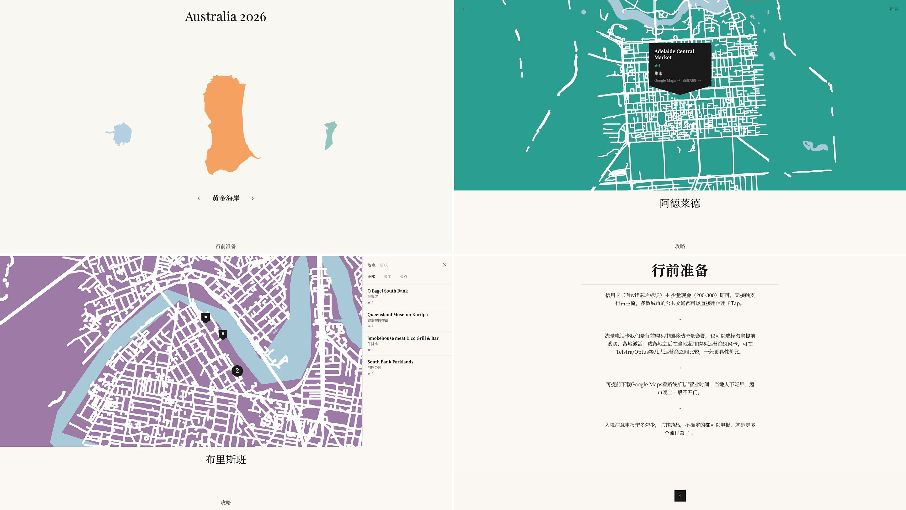

# TripSharer

🇨🇳 [中文版](README.md)

Back from a trip and everyone wants your recommendations? Log your spots and notes in Notion — TripSharer generates a beautiful map site you can share with anyone, instantly.



[Live Demo →](https://au2026.cathylau.com/index.html)

## Features

- **Stylized city maps**: Hand-drawn style SVG maps with every place you visited
- **City guides**: Notes and tips pulled directly from your Notion pages
- **Places & routes**: Tap any pin to see ratings, notes, and navigation links
- **One link to share**: Opens in any browser, no login required

## Working with an Agent

Use a local Agent such as Claude Code or Codex that can read and write project files, run commands, and access Notion and map services. A text-only chatbot cannot complete the workflow independently. If command access is restricted, the Agent can provide commands to run in a local terminal.

## Setup

Prepare:

- **Notion account**: fill in and manage travel records.
- **GitHub account**: keep a project copy and publish with GitHub Pages.
- **Local AI Agent**: configure the project, generate the website, and check the result.

Node.js 20.9 or newer is required. The Agent should check the installed version before installing dependencies.

1. Duplicate the [Notion template](https://www.notion.so/cccathylau/TripSharer-Template-17a0c7ad070a82de8cbb01e252863fee) into a personal workspace.
2. Fill in places, ratings, notes, and guides, or use the sample content for a first preview.
3. Fork this repository and clone it locally; let the Agent check the environment and install dependencies with `npm ci`.
4. Create a read-content Integration in [Notion Developer tools](https://www.notion.so/my-integrations). Add it through Connections on the duplicated overview, city pages, and Places database. Save its Token in local `.env`, and put the duplicated page/database IDs in `trips.config.js`. Never commit `.env`.
5. Generate and check the [local preview](#local-preview).
6. Confirm the content may be public, then follow [Deployment](#deployment).
7. After editing Notion, fetch, check, rebuild, preview, and publish again.

Places with Lat/Lng use those coordinates directly. For international places without coordinates, Nominatim is available and a [Google Maps API key](https://console.cloud.google.com/) is optional. Mainland China places without coordinates require a [Gaode API key](https://lbs.amap.com/). Correct Address or fill Lat/Lng if geocoding fails.

## Hand Off to Agent

The repository includes a local trial [TripSharer Skill](skills/tripsharer/SKILL.md) for setup, generation, preview, and updates. It is not an installed skill and has not completed independent fresh-session or multi-Agent installation acceptance.

```text
Read skills/tripsharer/SKILL.md and follow its workflow to generate and preview my travel website. Inspect and preserve existing settings; guide me through missing information. Do not commit, push, or publish.
```

Without the Skill, provide the Fork URL or local project directory and this instruction:

> Configure TripSharer following the README, then generate and verify a local preview. Do not commit, push, or publish yet.
>
> - Project: my Fork URL / local directory
> - Notion Token and required API keys: stored in local `.env`; guide setup if missing and never display them
> - Duplicated Places database link or ID: xxx
> - Overview page link or ID: xxx
> - [City] Notes page link or ID: xxx
> - City: [English city name, country]
> - Publishing destination: GitHub Pages / Tencent Cloud COS / decide after preview
>
> Explain each stage's purpose and impact. Only change this project. Preserve existing settings and do not edit Notion content without confirmation. After preview, explain publishing and obtain explicit authorization before committing, pushing, or publishing.

## Updating Content

Notion edits do not update the website immediately.

1. Follow [Local Preview](#local-preview) to fetch, check, build, and verify output. Stop and resolve failed checks.
2. Refresh a running preview or start `npm run preview`, then verify the requested changes.
3. After confirming the result, publish using the original destination. For GitHub Pages, commit updated `data/` and any changed configuration, then push to main. Alternatively, manually run Fetch Notion Data after configuring its Secrets.

Code changes pushed to main also trigger a rebuild and deployment. Agents need explicit authorization for commit, push, and publication.

## Technical Reference

### Environment Variables

| Variable | Purpose | Required |
|----------|---------|----------|
| `NOTION_TOKEN` | Notion Integration Token | Yes |
| `GOOGLE_MAPS_KEY` | Google geocoding, better accuracy for international cities | Recommended |
| `GAODE_KEY` | Gaode geocoding | Mainland China places without coordinates |
| `TENCENT_SECRET_ID` | Tencent Cloud COS credentials | COS deployment only |
| `TENCENT_SECRET_KEY` | Tencent Cloud COS credentials | COS deployment only |

### trips.config.js

```js
"my-trip": {
  databaseId: "",          // Notion Places database ID
  overviewPageId: "",      // Overview page ID
  cityPageIds: {           // city key → city Notes page ID
    sydney: "",
  },
  citySearchTerms: {       // city key → search term for map boundary
    sydney: "Sydney, Australia",
  },
  cityColors: {            // optional; auto-assigned from palette if omitted
    sydney: "#E85D4A",
  },
  cityUrbanBBox: {         // optional; bbox [south, west, north, east] for road data
    // sydney: [-33.95, 151.10, -33.80, 151.30],
  },
  cityZhNames: {           // Chinese city names for Baidu Maps navigation links
    sydney: "City Name",
  },
  region: "international", // "international" or "domestic" (mainland China, uses Gaode)
  countryName: "Australia",
  theme: { primary: "#E85D4A" },
  siteUrl: "https://your-username.github.io/TripSharer-Template",
}
```

**How to get a Notion ID**: Open the page or database, copy the URL. The ID is the 32-character string before `?v=` (remove hyphens).

### Local Preview

Run from the repository directory:

```bash
npm run fetch -- my-trip
node scripts/check-project.js --trip my-trip --stage data
npm run build -- my-trip
node scripts/check-project.js --trip my-trip --stage build
npm run preview
```

Open the local URL printed in the terminal. Check map pins, Label, ratings, Short Note, stop order for each day, Day Note, overview, and city notes. The preview server runs only on your computer; press Ctrl+C to stop. `my-trip` must match the configured trip ID. Building another trip automatically updates the default trip loaded by the website.
Keep the terminal running while previewing. After editing Notion, run fetch and build again, then refresh the page. Restarting preview may change the port in its URL. Without a cover photo, the build uses a default background and still generates the website.

The example configuration uses `sydney` and `melbourne`, matching the Notion template. Fill in the page IDs to use that example. For your own trip, update the city keys, search terms, display names, and country together. Leave `cityUrbanBBox` empty to use city boundary bounds.

### Notion Database Schema

**Places Database**

| Field | Type | Description |
|-------|------|-------------|
| Name | Title | Place name |
| City | Select | City key — must match the key in `trips.config.js` |
| Category | Select | Type (attraction / restaurant / shopping, etc.) |
| Address | Rich Text | Place address; used for geocoding when Lat/Lng are blank |
| Lat | Number | Latitude; auto-fetched if blank |
| Lng | Number | Longitude; auto-fetched if blank |
| Rating | Number | Rating 1–5 |
| Label | Rich Text | Short label, shown in the map popup |
| Short Note | Rich Text | One-line summary, shown below the rating |
| Day | Number | Day number (1/2/3…), used for route grouping |
| Stop Order | Number | Order within the day |
| Day Note | Rich Text | Day-level note; fill once on the first place of the day |

**Overview Page and City Notes Pages**

- **Overview Page**: Pre-trip info (SIM card, currency, packing list, etc.). Supports paragraphs, H1 headings, ordered/unordered lists.
- **City Notes Pages**: One page per city for transport tips, local advice, etc. Display names use `cityZhNames` first, or the page title when no override is configured.
- **City theme color**: Add a Callout block anywhere on the page with a 🎨 emoji, and write a hex value (`#E85D4A`) or color name (`coral`). It's picked up automatically during fetch.

### Deployment

**GitHub Pages (default)**

Local generation, GitHub publishing:

1. Verify the local preview and confirm the content may be public. Set `siteUrl` to `https://[username].github.io/[repo-name]`.
2. In repository Settings → Pages → Source, select **GitHub Actions**.
3. Commit the project changes, `trips.config.js`, and generated `data/*.json`, then push to main. The default is the first configured trip. Keep `.env` local.
4. Check Deploy to GitHub Pages in Actions, then open the published URL. Manual runs optionally accept `trip_id` to select a trip.

This path uses generated data and does not require a Notion Token in GitHub. Actions checks data before building and output after building; a failed check stops publication.

`dist/data/` contains only the selected trip and its configured cities. Other trip data committed to a public repository remains accessible through that repository; review all committed content before publishing.

Optional: let GitHub read Notion:

Add `NOTION_TOKEN` in Settings → Secrets and variables → Actions. Add `GOOGLE_MAPS_KEY` if used, or `GAODE_KEY` for mainland China places needing automatic coordinates. Run Fetch Notion Data manually. It checks fetched data before committing, then deploys to GitHub Pages. Failed checks stop the workflow.

**Tencent Cloud COS (better for mainland China access)**

For mainland China access, consider the COS Hong Kong region. Account, bucket, access, credentials, and cost settings are described in [`docs/cos-setup.md`](docs/cos-setup.md) for setup, then run:

```bash
npm run deploy -- my-trip
```

### FAQ

**Geocoding fails**
Check that the Address field is filled in Notion. For mainland China cities, make sure `GAODE_KEY` is set.

**Fetch is slow**
The first run downloads road network and water body data for each city — expect 5–10 minutes. Subsequent runs resume from cache.

**GitHub Actions fails**
Check the failed step: Notion reads require page access, correct IDs, and Secrets; build failures require valid configuration and data; publication requires Pages Source to be GitHub Actions.

**COS CORS error**
The COS bucket needs CORS configured. See `docs/cos-setup.md`.
