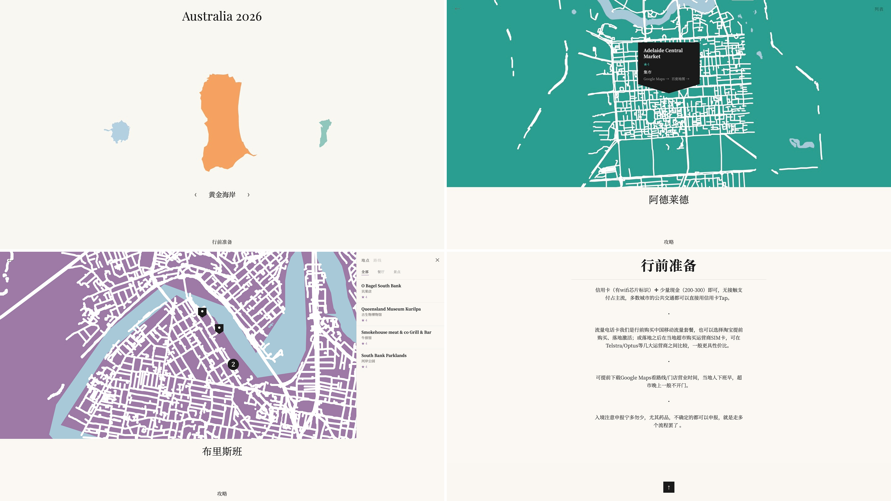

# TripSharer

🌏 [English](README.en.md)

旅游回来，总被问攻略？把 Notion 中的旅行记录整理成地图网站，分享沿途地点和旅行心得。

TripSharer 是一个旅行地图网站模板。在 Notion 中填写内容，通过本地 AI Agent 完成配置、生成和预览，确认后再发布到自己的网址。



[查看示例 →](https://au2026.cathylau.com/index.html)

[功能](#功能) · [使用步骤](#使用步骤) · [交给 Agent](#交给-agent) · [内容更新](#内容更新) · [自定义](#自定义) · [部署](#部署) · [常见问题](#常见问题)

## 功能

- **城市地图**：以手绘风格展示城市轮廓和已定位的旅行地点
- **地点与筛选**：按分类浏览地点，查看标签、评分和备注
- **每日路线**：按天查看地点顺序和当天备注
- **总览与城市攻略**：从 Notion 读取行前信息、交通、住宿和旅行心得
- **网址分享**：发布后通过链接访问，访客无需登录
- **内容更新**：在 Notion 中继续补充旅行记录，重新生成并发布到原网址

## 适用 Agent

- **适用工具**：Claude Code、Codex 等可操作本地项目的 AI Agent。
- **所需能力**：读写项目文件、执行命令，并访问 Notion 和地图数据服务。
- **权限受限时**：由 Agent 提供具体命令，在本地终端执行。仅支持文字对话的 Chatbot 无法独立完成配置和生成。

## 使用步骤

**开始前需要准备什么？**

- **Notion 账号**：填写和管理旅行记录。
- **GitHub 账号**：保存项目副本，并用于 GitHub Pages 发布。
- **本地 AI Agent**：协助配置项目、运行命令和生成网站，需具备上述操作能力。

内容填写、账号授权和发布确认由使用者完成；项目配置、生成和检查可交给 Agent 协助。也可按下方的手动步骤操作。

| 步骤 | 操作 | 完成结果 |
|------|------|----------|
| **1. 复制 Notion 模板** | 打开 [Notion 模板](https://www.notion.so/cccathylau/TripSharer-Template-17a0c7ad070a82de8cbb01e252863fee)，复制到自己的工作区 | 得到可编辑的总览、城市攻略和 Places 数据库 |
| **2. 填写旅行内容** | 按模板说明填写内容，或先用示例试跑；由 Agent 检查字段 | 准备好地点、评分、备注和攻略 |
| **3. 准备网站项目** | 在 GitHub Fork 本仓库；由 Agent 协助 clone 到电脑、检查环境并安装依赖 | 得到独立的项目副本和本地工作目录 |
| **4. 授权读取 Notion** | 创建 Integration 并授权复制后的模板；由 Agent 协助配置 Token 和页面 ID | 本地程序能够读取旅行内容 |
| **5. 生成并预览** | 由 Agent 读取内容并生成网页，打开[本地预览](#本地预览)检查效果 | 确认内容与操作正常，准备发布 |
| **6. 确认并发布** | 选择发布方式，确认内容可以公开后，由 Agent 协助发布并检查网址 | 通过 [GitHub Pages](#github-pages默认) 或[腾讯云 COS](#腾讯云-cos适合国内访问)获得可分享的网址 |
| **7. 更新内容** | 在 Notion 补充记录，由 Agent 重新读取、生成和检查，确认后发布 | 原网址显示新内容 |

**Notion 配置**

- **创建连接**：在 [Notion Developer tools](https://www.notion.so/my-integrations) 中创建 Integration，选择模板所在工作区，启用读取内容权限。
- **授权页面**：在复制后的总览、城市攻略和 Places 数据库右上角 Connections 中添加该连接。
- **填写配置**：Token 保存到本地 `.env`，不提交到 Git；页面 ID 填入 `trips.config.js`，使用复制后的页面与数据库。获取方式见[配置参考](#tripsconfigjs-配置)。

**地址定位与 API Key**

- **已有坐标**：填写 Lat、Lng 的地点直接使用现有坐标。
- **国际城市，坐标留空**：使用 Nominatim 尝试定位；[Google Maps API Key](https://console.cloud.google.com/)为推荐项。
- **中国大陆城市，坐标留空**：需配置[高德 API Key](https://lbs.amap.com/)。
- **定位失败**：修正 Address，或补填 Lat、Lng 后重新读取。

## 交给 Agent

**Skill 本地试用（初版）**

仓库中的 [TripSharer Skill](skills/tripsharer/SKILL.md) 已提供配置、生成、预览和更新流程，目前为本地试用稿，尚未完成独立会话验收或多 Agent 安装验证。可在本地 Agent 中打开本项目，要求先阅读该文件并按流程执行；这不等同于已安装可自动调用的 Skill。

```text
阅读 skills/tripsharer/SKILL.md，按其中流程根据我的 Notion 旅行记录生成网站并完成本地预览。先检查已有配置，缺少的信息逐项引导填写；不提交、推送或发布。
```

未使用 Skill 时，也可使用以下指令：

Fork 仓库后，将仓库链接或本地目录与下面这段指令一起交给 Agent。已知的页面 ID 可直接填写，也可先提供页面链接，由 Agent 协助整理；尚未准备好的配置可逐项完成。

> 帮我按 README 配置 TripSharer，先生成网站并完成本地预览，暂不提交、推送或发布。
>
> - 项目：我的 Fork 仓库链接 / 本地项目目录
> - Notion Token 和所需 API Key：保存在本地 `.env`；尚未填写时请指导我配置，不要在输出中展示
> - 复制后的 Places 数据库链接或 ID：xxx
> - 总览页链接或 ID：xxx
> - [城市名] Notes 页链接或 ID：xxx
> - 城市：[城市英文名, 国家]（用于地图边界，如 Sydney, Australia）
> - 发布方式：GitHub Pages / 腾讯云 COS / 预览后决定
>
> 每一步先说明目的和影响，再执行。只修改这个项目，不改我的其他项目或 Notion 内容；需要调整内容时先与我确认。预览通过后，再说明发布步骤，由我确认是否提交、推送和发布。

<details>
<summary>手动配置步骤</summary>

1. Fork 并 clone 仓库，确认 Node.js 20.9 或更新版本已安装，再运行 `npm ci`
2. 首次将 `.env.example` 复制为 `.env`，填入 Token 和所需 API Key；可选项不使用时留空，已有 `.env` 不要覆盖
3. 编辑 `trips.config.js`，填入复制后的 Notion 各页面 ID、城市信息和最终发布地址 `siteUrl`；不要使用原模板的页面 ID
4. 按[本地预览](#本地预览)中的命令读取内容、生成网页并检查
5. 确认内容正确且可以公开后，按[部署](#部署)步骤提交和发布。由 Agent 操作时，先取得明确授权；不要提交 `.env`

</details>

## 内容更新

**更新了 Notion 内容**（新增地点、修改评分或补充攻略）

Notion 修改不会即时同步网站。更新分为三步：

1. **读取与生成**：按[本地预览](#本地预览)中的顺序运行读取、数据检查、构建和构建检查；检查失败时先处理，再继续。
2. **检查预览**：预览已在运行时刷新页面；否则运行 `npm run preview`，检查修改是否生效。
3. **发布更新**：确认内容正确后，按首次选择的方式发布。

- **GitHub Pages**：提交更新后的 `data/`；配置有变化时一并提交 `trips.config.js`，推送到 main 后由 Actions 构建并发布。
- **腾讯云 COS**：运行 `npm run deploy -- my-trip`，重新构建并上传。

**可选：通过 GitHub Actions 更新**

配置 GitHub Secrets 后，在仓库 Actions → Fetch Notion Data → Run workflow 中填写行程 ID。此操作会读取 Notion、自动提交数据，并直接发布到 GitHub Pages，不包含本地预览步骤。

**更新了代码**
本地重新构建并检查后，再提交代码。GitHub Pages 随 main 分支推送自动构建并发布；COS 需要重新运行 deploy。由 Agent 操作时，提交、推送和发布均需用户明确授权。

<br>

## 自定义

- **旅行标题**：修改 Notion 模板主页的标题。总览页应保留在该主页下，分栏内也可读取；无法读取主页标题时，使用配置中的 `coverMeta.title`。
- **城市显示名**：在 `trips.config.js` 的 `cityZhNames` 中设置；未设置时读取对应城市攻略页的标题。显示名可以更改，城市 key 仍需与 Places 的 City 字段一致。
- **地点分类**：在 Notion 的 Category 字段中添加或修改分类，网页根据地点内容生成筛选选项。
- **岛屿与城市配色**：通过各城市攻略页的 🎨 Callout 设置，具体方式如下。

### 修改岛屿与城市配色

1. 打开 Notion 中对应的城市攻略页。
2. 添加或编辑一个图标为 🎨 的 Callout，在正文中填写颜色名或六位 Hex 色值，例如 `蓝色`、`coral`、`#2A9D8F`。
3. 重新读取内容、生成网页并刷新预览；检查后再发布更新。

城市颜色用于首页岛屿和城市页面的相关配色。Callout 的图标需为 🎨；修改 Callout 自身的背景色不会设置网站颜色。每个城市建议只保留一条配色设置。

也可直接设置 `trips.config.js` 中的 `cityColors`。读取时的优先级为：**Notion 中可识别的颜色 → 配置中的城市颜色 → 自动分配颜色**。要改用配置颜色，应同时移除 Notion 中的配色设置。

<details>
<summary>颜色名与色值参考</summary>

以下为程序内置的基础颜色。可填写表中的中文名、英文名或 Hex 色值；如需指定准确颜色，建议直接填写 Hex。

| 中文名 | 英文名 | Hex |
|--------|--------|-----|
| 红 | red | `#C0524A` |
| 砖红 | brick | `#B84C3C` |
| 珊瑚 | coral | `#E87060` |
| 玫 | rose | `#C2546A` |
| 粉 | pink | `#D17B8B` |
| 橙 | orange | `#E4906B` |
| 黄 | yellow | `#D4A24A` |
| 绿 | green | `#6B9E6B` |
| 橄榄 | olive | `#7A8C5A` |
| 青 | teal | `#2A9D8F` |
| 薄荷 | mint | `#3D9E7A` |
| 蓝 | blue | `#4A7B96` |
| 青蓝 | cyan | `#3E7A96` |
| 深蓝 | navy | `#2C4E6E` |
| 紫 | purple | `#9B7AA6` |
| 薰衣草 | lavender | `#8E7AB5` |
| 棕 | brown | `#A37056` |
| 驼 | camel | `#B8A06A` |
| 灰 | gray | `#6B6B6B` |
| 白 | white | `#F5F1EC` |
| 黑 | black | `#2C2C2C` |

颜色名前可加“亮、浅、淡”提亮，或“深、暗”压暗，例如 `亮蓝色`、`淡绿色`。基础色中的“深蓝”会优先按表中固定色值识别。此表为颜色名映射，未指定颜色时的自动分配使用另一组调色板。

</details>

## 技术配置参考

### 环境变量

| 变量名 | 用途 | 必填 |
|--------|------|------|
| `NOTION_TOKEN` | Notion Integration Token | 是 |
| `GOOGLE_MAPS_KEY` | Google 地理编码，国际城市精度更高 | 推荐 |
| `GAODE_KEY` | 高德地图 API Key | 国内地点需要自动定位时 |
| `TENCENT_SECRET_ID` | 腾讯云 COS 上传凭证 | 仅 COS 部署需要 |
| `TENCENT_SECRET_KEY` | 腾讯云 COS 上传凭证 | 仅 COS 部署需要 |

### trips.config.js 配置

保留文件中的 `export const TRIPS = { ... }` 结构，按以下用途填写各项：

- **连接 Notion**：Places 数据库、总览页和各城市攻略页的 ID。
- **定义旅行**：城市 key、显示名称、国家和配色。Notion 的 City 字段需与城市 key 一致，例如 `sydney`。
- **准备发布**：最终网站地址 `siteUrl`。
- **可选设置**：`cityUrbanBBox` 用于限定城区路网范围，可先留空。

`my-trip` 是行程标识，下面示例为 `TRIPS` 中的一个条目；命令中的行程标识必须与配置一致。

```js
"my-trip": {
  databaseId: "",          // Notion Places 数据库 ID
  overviewPageId: "",      // 行程总览 Page ID
  cityPageIds: {           // 城市 key → 城市 Notes Page ID
    sydney: "",
  },
  citySearchTerms: {       // 城市 key → 城市边界搜索词（用于抓取地图轮廓）
    sydney: "Sydney, Australia",
  },
  cityColors: {            // 可选，城市主题色；未指定时自动从调色板分配
    sydney: "#E85D4A",
  },
  cityUrbanBBox: {         // 可选，城区 bbox [南, 西, 北, 东]，限定路网抓取范围
    // sydney: [-33.95, 151.10, -33.80, 151.30],
  },
  cityZhNames: {           // 城市中文名，用于百度地图导航链接
    sydney: "城市名",
  },
  region: "international", // "international" 或 "domestic"（中国大陆，使用高德地理编码）
  countryName: "Australia",
  theme: { primary: "#E85D4A" },
  siteUrl: "https://your-username.github.io/TripSharer-Template",
}
```

**Notion ID 获取方式**：打开页面或数据库，URL 格式为 `notion.so/[workspace]/[32位ID]?v=...`，取 `?v=` 前的 32 位字符串（去掉连字符）。

### 本地预览

在仓库目录运行：

```bash
npm run fetch -- my-trip
node scripts/check-project.js --trip my-trip --stage data
npm run build -- my-trip
node scripts/check-project.js --trip my-trip --stage build
npm run preview
```

前一条命令成功后再运行下一条。打开终端显示的本地地址，检查：

- 城市、地点及分类筛选。
- 地点弹窗中的 Label、评分和 Short Note。
- 每日路线顺序和 Day Note。
- 总览与各城市攻略。

预览期间保持终端运行，按 Ctrl+C 停止；重新启动时地址中的端口可能改变。没有封面照片时，构建会使用默认底色。

配置示例与 Notion 模板使用 `sydney`、`melbourne` 两个城市。填写页面 ID 后可用于这份示例；改成自己的旅行时，同步修改城市 key、搜索词、显示名称和国家。`cityUrbanBBox` 可保持为空，由程序使用城市边界范围。

### Notion 数据库结构

**Places Database**

| 字段名 | 类型 | 说明 |
|--------|------|------|
| Name | Title | 地点名称 |
| City | Select | 城市 key，需与 `trips.config.js` 的城市 key 一致 |
| Category | Select | 分类（景点 / 餐厅 / 购物等） |
| Address | Rich Text | 地点地址；Lat/Lng 留空时据此获取坐标 |
| Lat | Number | 纬度，留空时自动抓取 |
| Lng | Number | 经度，留空时自动抓取 |
| Rating | Number | 评分 1–5 |
| Label | Rich Text | 简短标签，显示在地图弹窗 |
| Short Note | Rich Text | 一行概括，显示在弹窗评分下方 |
| Day | Number | 所属天数（1/2/3…），用于路线视图分组 |
| Stop Order | Number | 当天内顺序 |
| Day Note | Rich Text | 当天整体备注，只需在当天第一个地点填写 |

**Overview Page 和城市 Notes Page**

- **Overview Page**：出发前信息（SIM 卡、货币、打包清单等），支持段落、H1 标题、有序 / 无序列表
- **城市 Notes Page**：每个城市一个页面，交通 / 贴士 / 购物等内容；城市显示名优先使用 `cityZhNames`，未设置时读取页面标题
- **城市主题色**：通过图标为 🎨 的 Callout 设置，操作与色值参考见[自定义配色](#修改岛屿与城市配色)

### 部署

#### GitHub Pages（默认）

**本地生成，GitHub 发布**

1. 确认本地预览通过，内容可以公开；将 `siteUrl` 设置为 `https://[username].github.io/[repo-name]`。
2. 在仓库 Settings → Pages → Source 中选择 **GitHub Actions**。
3. 提交 `trips.config.js` 和生成的 `data/*.json`，推送到 main。默认构建配置中的第一个行程；`.env` 保留在本地。
4. 在 Actions 中查看 Deploy to GitHub Pages 的执行结果，完成后打开网站地址检查。也可手动运行该流程，填写 `trip_id` 选择行程。

这条路径使用已生成的数据，不需要将 Notion Token 添加到 GitHub。Actions 会在构建前检查数据、构建后检查输出；检查失败不会继续发布。

`dist/data/` 只包含选定行程及其配置城市的数据。公开仓库中已提交的其他行程数据仍可被访问，提交前应一并确认公开范围。

**可选：让 GitHub 读取 Notion**

在仓库 Settings → Secrets and variables → Actions 中添加：

- `NOTION_TOKEN`：读取 Notion 内容。
- `GOOGLE_MAPS_KEY`：可选，用于国际地点自动定位。
- `GAODE_KEY`：国内地点需要自动定位时填写。

随后运行 Fetch Notion Data 流程。它会读取内容，通过数据检查后自动提交生成的数据，再发布到 GitHub Pages；检查失败会停止。

#### 腾讯云 COS（适合国内访问）

面向国内访问时可选择腾讯云 COS 香港地域。账号、存储桶、访问方式、上传凭证和费用设置见 [COS 部署指引](docs/cos-setup.md)，配置后运行：

```bash
npm run deploy -- my-trip
```

### 常见问题

**地理编码失败**
检查输出中哪些地点缺少坐标，补充或修正 Notion 的 Address，必要时填写 Lat、Lng 后重新读取。中国大陆城市需设置 `GAODE_KEY`。

**fetch 很慢**
首次需要下载城市边界、路网和水域数据，耗时取决于城市范围和网络情况；后续运行会复用已有地图缓存。

**GitHub Actions 失败**
先查看失败的步骤：读取 Notion 时检查页面授权、ID 和 Secrets；构建时检查配置与数据文件；发布时检查 Pages Source 是否设为 GitHub Actions。

**COS 跨域报错**
COS bucket 需配置 CORS，参考 `docs/cos-setup.md`
