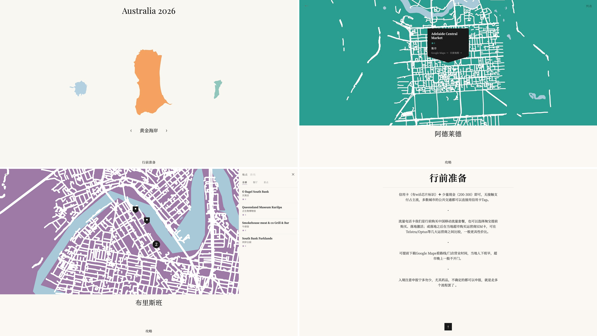

# TripSharer

🌏 [English](README.md)

旅游回来，总被问攻略？把 Notion 中的旅行记录整理成地图网站，分享沿途地点和旅行心得。

TripSharer 是一个旅行地图网站模板。在 Notion 中填写内容，通过本地 AI Agent 完成配置、生成和预览，确认后再发布到自己的网址。



[查看示例 →](https://au2026.cathylau.com/index.html)

[功能](#功能) · [开始前准备](#开始前准备) · [使用 Skill](#使用-tripsharer-skill推荐) · [常见使用场景](#常见使用场景) · [发布与分享](#发布与分享) · [技术参考](#手动操作与技术参考) · [常见问题](#常见问题)

## 功能

- **城市地图**：以手绘风格展示城市轮廓和已定位的旅行地点
- **地点与筛选**：按分类浏览地点，查看标签、评分和备注
- **每日路线**：按天查看地点顺序和当天备注；不提供实时交通或逐段导航规划
- **总览与城市攻略**：从 Notion 读取行前信息、交通、住宿和旅行心得
- **网址分享**：发布后通过链接访问，访客无需登录
- **内容更新**：在 Notion 中继续补充旅行记录，重新生成并发布到原网址

## 开始前准备

以下账号用于制作自己的网站；快速体验仅需本地 Agent 和运行环境。

- **Notion 账号**：填写和管理旅行记录。
- **GitHub 账号**：保存项目副本，并用于 GitHub Pages 发布。
- **本地 AI Agent**：Claude Code、Codex 等，需能够读写项目文件、执行命令并联网。

内容填写、账号授权和发布确认由你完成；配置、生成和检查可由 Agent 引导。

## 使用 TripSharer Skill（推荐）

[TripSharer Skill](skills/tripsharer/SKILL.md) 会引导本地 Agent 检查配置、读取 Notion、生成网站并完成预览。你负责填写旅行内容、完成账号授权，以及确认发布。

使用时由 Agent 读取项目中的 Skill 文件，无需全局安装。

### 选择使用方式

| 方式 | 适合什么情况 | 操作流程 |
|---|---|---|
| **快速体验** | 先看看网站效果 | 使用仓库自带示例数据 → 生成 → 本地预览，无需 Notion Token |
| **制作自己的网站** | 展示自己的旅行记录 | 复制 Notion 模板到自己的工作区 → 编辑内容 → 授权读取 → 生成与预览 → 确认后发布 |

快速体验是可选步骤，也可以直接制作自己的网站。两种方式生成的都是完整网站，区别在于内容来源。

#### 快速体验

可以直接告诉 Agent：

```text
请读取 TripSharer Skill，使用仓库自带的示例数据生成本地预览。不要连接 Notion，也不要发布。
```

示例数据位于 `data/my-trip*.json`，是从 Notion 模板导出的内容快照及配套地图数据，不会随 Notion 修改自动更新。无需复制模板、配置 Token 或运行 fetch；仍需 Node.js 20.9+ 及项目依赖。

也可在项目目录中依次运行（首次使用先运行 `npm ci`）：

```bash
node scripts/check-project.js --trip my-trip --stage data
npm run build -- my-trip
node scripts/check-project.js --trip my-trip --stage build
npm run preview
```

每条命令成功后再继续，打开终端显示的预览地址。快速体验只检查数据与生成结果，跳过需要 Token 的配置及联网检查。

### 制作自己的网站


Agent 会从准备项目开始逐步引导。已有项目和配置会保留使用，缺少的信息再逐项补充。

```text
请用 TripSharer 模板，根据我的 Notion 旅行记录生成并预览网站。

先阅读仓库 README、AGENTS.md 和 skills/tripsharer/SKILL.md。
请先检查已有内容，再引导我完成剩余步骤，包括准备本地项目、复制 Notion 模板、填写旅行记录、授权和配置。
下载项目前，请确认保存位置；如果项目已存在，请保留已有配置和改动。
请指导我在本地填写密钥，不要在聊天或日志中显示密钥。
仅操作本次任务的项目文件夹；Notion 内容由我填写。
先生成本地预览供我检查，确认内容和效果后，再引导我选择发布方式；发布前与我确认。
```

各阶段的分工如下：

| 阶段 | 你需要做什么 | Agent 协助什么 |
|---|---|---|
| 准备项目 | 确认电脑上的保存位置 | 阅读项目说明、下载项目、检查运行环境；需要 Fork 时指导创建 |
| 准备内容 | 复制 [Notion 模板](https://www.notion.so/cccathylau/TripSharer-Template-17a0c7ad070a82de8cbb01e252863fee)，填写旅行记录或先使用示例，并提供页面链接 | 说明所需页面与城市信息 |
| 授权与配置 | 完成 Notion 授权，在本地填写密钥 | 引导配置并检查是否能读取所需页面 |
| 生成与预览 | 打开预览，确认内容和效果 | 读取、生成、检查网站 |
| 发布与更新 | 选择发布方式并确认公开内容 | 确认获得发布授权后执行，之后按需更新网站 |

已有本地项目时，直接在 Agent 中打开项目文件夹，说“请读取 `skills/tripsharer/SKILL.md`，按现有配置生成并预览网站”。Agent 会先检查现有配置，仅补齐缺失项，无需从头配置。

首次生成需要 Node.js **20.9 或更新版本**，可由 Agent 检查环境并协助安装依赖。发布方式和网址可在预览后决定。仅支持文字对话、无法操作本地文件或执行命令的 Chatbot，不能独立完成流程；权限受限时可由 Agent 提供命令，指导在本地终端执行。

## 常见使用场景

在项目中让 Agent 先读取 Skill 后，可以继续用自然语言提出任务：

| 你可以这样说 | Agent 会做什么 |
|---|---|
| 根据我的 Notion 记录生成旅行网站，先预览 | 检查配置与权限，读取内容，生成并检查本地网页 |
| 我新增了几个地点，更新一下预览 | 保留配置，重新读取和生成，检查新增内容 |
| 我改了城市配色，检查网页效果 | 检查 Notion 配色与配置优先级，重新生成并预览 |
| 帮我准备发布到 GitHub Pages | 检查发布配置和公开内容，说明操作，取得相应授权后发布 |

Notion 修改不会即时同步网站；预览确认后，还需发布才能更新线上内容。具体更新步骤见[内容更新](#内容更新)，配色方法见[自定义](#自定义)。

## 发布与分享

先选发布方式：GitHub Pages 是默认流程；如更重视中国大陆访问，可考虑腾讯云 COS。先完成本地预览，再确认旅行地点、日期和攻略等内容可以公开。由 Agent 操作时，提交、推送和发布需取得明确授权。

COS 及定位 API 等第三方服务可能产生费用，请查看所用服务的计费说明。预算告警、流量限制等保护措施由使用者按需选择，不作为发布的前置条件；文档中的金额与阈值仅为示例。

### GitHub Pages（默认）

**本地生成，GitHub 发布**

1. 确认本地预览通过，内容可以公开；将 `siteUrl` 设置为 `https://[username].github.io/[repo-name]`。
2. 在仓库 Settings → Pages → Source 中选择 **GitHub Actions**。
3. 提交 `trips.config.js` 和生成的 `data/*.json`，推送到 main。默认构建配置中的第一个行程；`.env` 保留在本地。
4. 在 Actions 中查看 Deploy to GitHub Pages 的执行结果，完成后打开网站地址检查。也可手动运行该流程，填写 `trip_id` 选择行程。

这条路径使用已生成的数据，不需要将 Notion Token 添加到 GitHub。Actions 会在构建前检查数据、构建后检查输出；检查失败不会继续发布。

`dist/data/` 只包含选定行程及其配置城市的数据。公开仓库中已提交的其他行程数据仍可被访问，提交前应一并确认公开范围。

**可选：让 GitHub 读取 Notion**

在仓库 Settings → Secrets and variables → Actions 中添加：

- `NOTION_TOKEN`：读取 Notion 内容。
- `GOOGLE_MAPS_KEY`：可选，用于国际地点自动定位。
- `GAODE_KEY`：国内地点需要自动定位时填写。

随后运行 Fetch Notion Data 流程。它会读取内容，通过数据检查后自动提交生成的数据，再发布到 GitHub Pages；检查失败会停止。

### 腾讯云 COS（适合国内访问）

面向国内访问时可选择腾讯云 COS 香港地域。新建 COS 存储桶需配置自定义域名及 HTTPS 才能正常提供网页预览；`cosUrl` 填存储桶上传地址，`siteUrl` 填对外网站根地址。账号、存储桶、访问方式、上传凭证和费用设置见 [COS 部署指引](docs/cos-setup.md)，配置后运行：

```bash
npm run deploy -- my-trip
```

COS 部署命令只重新构建并上传，不会读取最新 Notion 内容，也不会自动检查数据和构建结果。发布前请先完成[本地预览](#本地预览)中的检查。上传覆盖同名对象，但不会清除旧对象。仓库现有 GitHub Actions 发布到 Pages，不是 COS。

## 内容更新

**更新了 Notion 内容**（新增地点、修改评分或补充攻略）

Notion 修改不会即时同步网站。更新分为三步：

1. **读取与生成**：按[本地预览](#本地预览)中的顺序运行读取、数据检查、构建和构建检查；检查失败时先处理，再继续。
2. **检查预览**：预览已在运行时刷新页面；否则运行 `npm run preview`，检查修改是否生效。
3. **发布更新**：确认内容正确后，按首次选择的方式发布。

- **GitHub Pages**：提交更新后的 `data/`；配置有变化时一并提交 `trips.config.js`，推送到 main 后由 Actions 构建并发布。
- **腾讯云 COS**：运行 `npm run deploy -- my-trip`，重新构建并上传。

**可选：通过 GitHub Actions 更新**

配置 GitHub Secrets 后，在仓库 Actions → Fetch Notion Data → Run workflow 中填写行程 ID。此操作会读取 Notion、自动提交数据，并直接发布到 GitHub Pages，不包含本地预览步骤。

**更新了代码**
本地重新构建并检查后，再提交代码。GitHub Pages 随 main 分支推送自动构建并发布；COS 需要重新运行 deploy。由 Agent 操作时，提交、推送和发布均需用户明确授权。

## 自定义

- **旅行标题**：修改 Notion 模板主页的标题。总览页应保留在该主页下，分栏内也可读取；无法读取主页标题时，使用配置中的 `coverMeta.title`。
- **城市显示名**：在 `trips.config.js` 的 `cityZhNames` 中设置；未设置时读取对应城市攻略页的标题。显示名可以更改，城市 key 仍需与 Places 的 City 字段一致。
- **地点分类**：在 Notion 的 Category 字段中添加或修改分类，网页根据地点内容生成筛选选项。
- **岛屿与城市配色**：通过各城市攻略页的 🎨 Callout 设置，具体方式如下。

### 修改岛屿与城市配色

1. 打开 Notion 中对应的城市攻略页。
2. 添加或编辑一个图标为 🎨 的 Callout，在正文中填写颜色名或六位 Hex 色值，例如 `蓝色`、`coral`、`#2A9D8F`。
3. 重新读取内容、生成网页并刷新预览；检查后再发布更新。

城市颜色用于首页岛屿和城市页面的相关配色。Callout 的图标需为 🎨；修改 Callout 自身的背景色不会设置网站颜色。每个城市建议只保留一条配色设置。

也可直接设置 `trips.config.js` 中的 `cityColors`。读取时的优先级为：**Notion 中可识别的颜色 → 配置中的城市颜色 → 自动分配颜色**。要改用配置颜色，应同时移除 Notion 中的配色设置。

<details>
<summary>颜色名与色值参考</summary>

以下为程序内置的基础颜色。可填写表中的中文名、英文名或 Hex 色值；如需指定准确颜色，建议直接填写 Hex。

| 中文名 | 英文名 | Hex |
|--------|--------|-----|
| 红 | red | `#C0524A` |
| 砖红 | brick | `#B84C3C` |
| 珊瑚 | coral | `#E87060` |
| 玫 | rose | `#C2546A` |
| 粉 | pink | `#D17B8B` |
| 橙 | orange | `#E4906B` |
| 黄 | yellow | `#D4A24A` |
| 绿 | green | `#6B9E6B` |
| 橄榄 | olive | `#7A8C5A` |
| 青 | teal | `#2A9D8F` |
| 薄荷 | mint | `#3D9E7A` |
| 蓝 | blue | `#4A7B96` |
| 青蓝 | cyan | `#3E7A96` |
| 深蓝 | navy | `#2C4E6E` |
| 紫 | purple | `#9B7AA6` |
| 薰衣草 | lavender | `#8E7AB5` |
| 棕 | brown | `#A37056` |
| 驼 | camel | `#B8A06A` |
| 灰 | gray | `#6B6B6B` |
| 白 | white | `#F5F1EC` |
| 黑 | black | `#2C2C2C` |

颜色名前可加“亮、浅、淡”提亮，或“深、暗”压暗，例如 `亮蓝色`、`淡绿色`。基础色中的“深蓝”会优先按表中固定色值识别。此表为颜色名映射，未指定颜色时的自动分配使用另一组调色板。

</details>

## 手动操作与技术参考

<details>
<summary>手动配置步骤</summary>

1. Fork 并 clone 仓库，确认 Node.js 20.9 或更新版本已安装，再运行 `npm ci`
2. 首次将 `.env.example` 复制为 `.env`，填入 Token 和所需 API Key；可选项不使用时留空，已有 `.env` 不要覆盖
3. 编辑 `trips.config.js`，填入复制后的 Notion 各页面 ID、城市信息；`siteUrl` 可在确定发布网址后再填写，不影响本地预览。不要使用原模板的页面 ID
4. 按[本地预览](#本地预览)中的命令读取内容、生成网页并检查
5. 确认内容正确且可以公开后，按[发布与分享](#发布与分享)步骤提交和发布。由 Agent 操作时，先取得明确授权；不要提交 `.env`

</details>

### Notion 配置

- **创建连接**：在 [Notion Developer tools](https://www.notion.so/my-integrations) 中创建 Integration，选择模板所在工作区，启用读取内容权限。
- **授权页面**：在复制后的总览、城市攻略和 Places 数据库右上角 Connections 中添加该连接。
- **填写配置**：Token 保存到本地 `.env`，不提交到 Git，也不要粘贴到聊天中；页面 ID 填入 `trips.config.js`，使用复制后的页面与数据库。获取方式见[配置参考](#tripsconfigjs-配置)。
- **验证连接**：由 Agent 检查本地程序是否能实际读取数据库、总览和各城市页。ChatGPT 中已连接 Notion，不等于本项目的本地 Token 已配置或授权。

**地址定位与 API Key**

- **已有坐标**：填写 Lat、Lng 的地点直接使用现有坐标。
- **国际城市，坐标留空**：使用 Nominatim 尝试定位；[Google Maps API Key](https://console.cloud.google.com/)为推荐项。
- **中国大陆城市，坐标留空**：需配置[高德 API Key](https://lbs.amap.com/)。
- **定位失败**：修正 Address，或补填 Lat、Lng 后重新读取。

### 环境变量

| 变量名 | 用途 | 必填 |
|--------|------|------|
| `NOTION_TOKEN` | Notion Integration Token | 是 |
| `GOOGLE_MAPS_KEY` | Google 地理编码，国际城市精度更高 | 推荐 |
| `GAODE_KEY` | 高德地图 API Key | 国内地点需要自动定位时 |
| `TENCENT_SECRET_ID` | 腾讯云 COS 上传凭证 | 仅 COS 部署需要 |
| `TENCENT_SECRET_KEY` | 腾讯云 COS 上传凭证 | 仅 COS 部署需要 |

### trips.config.js 配置

保留文件中的 `export const TRIPS = { ... }` 结构，按以下用途填写各项：

- **连接 Notion**：Places 数据库、总览页和各城市攻略页的 ID。
- **定义旅行**：城市 key、显示名称、国家和配色。Notion 的 City 字段需与城市 key 一致，例如 `sydney`。
- **准备发布**：最终网站地址 `siteUrl`。
- **可选设置**：`cityUrbanBBox` 用于限定城区路网范围，可先留空。

`my-trip` 是行程标识，下面示例为 `TRIPS` 中的一个条目；命令中的行程标识必须与配置一致。

```js
"my-trip": {
  databaseId: "",          // Notion Places 数据库 ID
  overviewPageId: "",      // 行程总览 Page ID
  cityPageIds: {           // 城市 key → 城市 Notes Page ID
    sydney: "",
  },
  citySearchTerms: {       // 城市 key → 城市边界搜索词（用于抓取地图轮廓）
    sydney: "Sydney, Australia",
  },
  cityColors: {            // 可选，城市主题色；未指定时自动从调色板分配
    sydney: "#E85D4A",
  },
  cityUrbanBBox: {         // 可选，城区 bbox [南, 西, 北, 东]，限定路网抓取范围
    // sydney: [-33.95, 151.10, -33.80, 151.30],
  },
  cityZhNames: {           // 城市中文名，用于百度地图导航链接
    sydney: "城市名",
  },
  region: "international", // "international" 或 "domestic"（中国大陆，使用高德地理编码）
  countryName: "Australia",
  theme: { primary: "#E85D4A" },
  siteUrl: "https://your-username.github.io/TripSharer-Template",
}
```

**Notion ID 获取方式**：打开页面或数据库，URL 格式为 `notion.so/[workspace]/[32位ID]?v=...`，取 `?v=` 前的 32 位字符串（去掉连字符）。

### 本地预览

以下命令中的 `my-trip` 必须与 `trips.config.js` 中的行程标识一致。在仓库目录先检查配置和实际 Notion 读取权限：

```bash
node scripts/check-project.js --trip my-trip --stage config
node scripts/check-project.js --trip my-trip --stage config --network
```

配置和读取权限通过后，再依次运行：

```bash
npm run fetch -- my-trip
node scripts/check-project.js --trip my-trip --stage data
npm run build -- my-trip
node scripts/check-project.js --trip my-trip --stage build
npm run preview
```

前一条命令成功后再运行下一条。打开终端显示的本地地址，检查：

- 城市、地点及分类筛选。
- 地点弹窗中的 Label、评分和 Short Note。
- 每日路线顺序和 Day Note。
- 总览与各城市攻略。

文件检查通过后，还需在浏览器中检查上述内容与操作；没有打开页面验证时，不算完成预览验收。本地地址仅用于自己的电脑预览，分享给别人需要完成部署。

读取会更新 `data/`，构建会重新生成 `dist/`；不要在 `dist/` 中保存需要保留的手动修改。这些命令不会发布网站。

预览期间保持终端运行，按 Ctrl+C 停止；重新启动时地址中的端口可能改变。没有封面照片时，构建会使用默认底色。

配置示例与 Notion 模板使用 `sydney`、`melbourne` 两个城市。填写页面 ID 后可用于这份示例；改成自己的旅行时，同步修改城市 key、搜索词、显示名称和国家。`cityUrbanBBox` 可保持为空，由程序使用城市边界范围。

### Notion 数据库结构

**Places Database**

| 字段名 | 类型 | 说明 |
|--------|------|------|
| Name | Title | 地点名称 |
| City | Select | 城市 key，需与 `trips.config.js` 的城市 key 一致 |
| Category | Select | 分类（景点 / 餐厅 / 购物等） |
| Address | Rich Text | 地点地址；Lat/Lng 留空时据此获取坐标 |
| Lat | Number | 纬度，留空时自动抓取 |
| Lng | Number | 经度，留空时自动抓取 |
| Rating | Number | 评分 1–5 |
| Label | Rich Text | 简短标签，显示在地图弹窗 |
| Short Note | Rich Text | 一行概括，显示在弹窗评分下方 |
| Day | Number | 所属天数（1/2/3…），用于路线视图分组 |
| Stop Order | Number | 当天内顺序 |
| Day Note | Rich Text | 当天整体备注，只需在当天第一个地点填写 |

**Overview Page 和城市 Notes Page**

- **Overview Page**：出发前信息（SIM 卡、货币、打包清单等），支持段落、H1 标题、有序 / 无序列表
- **城市 Notes Page**：每个城市一个页面，交通 / 贴士 / 购物等内容；城市显示名优先使用 `cityZhNames`，未设置时读取页面标题
- **城市主题色**：通过图标为 🎨 的 Callout 设置，操作与色值参考见[自定义配色](#修改岛屿与城市配色)

## 常见问题

**Notion 连接失败或无权限**
先运行配置联网检查，确认 `.env` 已填写、Integration 属于正确工作区，且复制后的 Places、总览和各城市页均已授权。`ENOTFOUND` 等域名解析错误应先排查网络，不能据此判断 Token 或页面权限有误。

**配置检查通过，但地图细节缺失**
配置检查仅验证配置与读取权限，不能代替数据检查。如果提示缺少局部详细路网，先重新运行普通 fetch 补齐，再检查数据；不要一开始就清空所有缓存。

**修改 Notion 后网页没有变化**
需重新读取、生成并刷新本地预览；已发布的网站还需重新发布。单独刷新线上页面不会读取最新 Notion 内容。

**地理编码失败**
检查输出中哪些地点缺少坐标，补充或修正 Notion 的 Address，必要时填写 Lat、Lng 后重新读取。中国大陆地点需要自动定位时，需设置 `GAODE_KEY`。

**fetch 很慢**
首次需要下载城市边界、路网和水域数据，耗时取决于城市范围和网络情况；后续运行会复用已有地图缓存。

**GitHub Actions 失败**
先查看失败的步骤：读取 Notion 时检查页面授权、ID 和 Secrets；构建时检查配置与数据文件；发布时检查 Pages Source 是否设为 GitHub Actions。

**COS 跨域报错**
先检查网页和数据是否来自不同域名或端口，再按 [COS 部署指引](docs/cos-setup.md) 排查跨域配置和访问权限。
